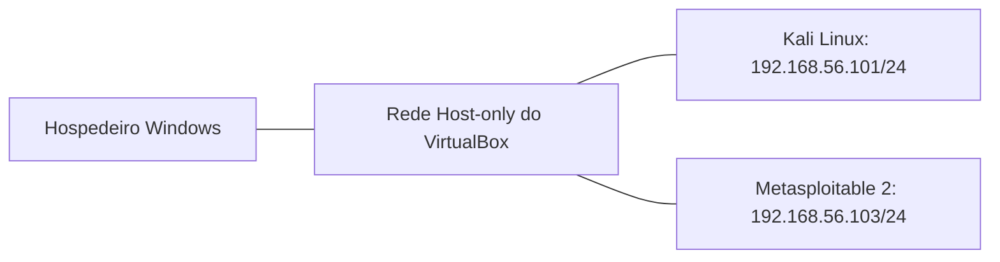

# Laboratório de auditoria de senhas com Kali Linux e Medusa

**Autor:** Anderson Junior  
**Bootcamp:** Santander - Cibersegurança do Zero à Prática — DIO  
**Repositório:** https://github.com/Anderson0100/dio-kali-medusa-lab  
**Data dos testes:** 23/11/2026, conforme as capturas; fuso do relógio da VM não confirmado.

Projeto de estudo em VirtualBox: reconhecimento de serviços, testes de dicionário em FTP e DVWA, enumeração SMB e uma rodada de password spraying. O alvo foi a VM Metasploitable 2 do participante, em rede Host-only.

> **Três cenários documentados e 13 capturas originais incorporadas.** FTP, DVWA e SMB têm evidências visuais de identificação e confirmação de credenciais. O DVWA inclui a tentativa manual recusada, o acesso confirmado no navegador e a automação com sucesso na terceira candidata. Os logs brutos não foram recebidos. Medidas defensivas são recomendações, sem aplicação ou reteste.

## Resultados principais

| Cenário | Método | Resultado e validação |
| --- | --- | --- |
| FTP | Medusa: três senhas para msfadmin | msfadmin/msfadmin; cliente FTP retornou `230 Login successful` e `/home/msfadmin`. |
| DVWA Low | Python: três senhas para admin, em sessão autenticada | Duas falhas e sucesso na terceira candidata, password; a mesma credencial já havia sido confirmada no formulário. |
| SMB | Enumeração e uma senha para três usuários | Medusa indicou msfadmin/msfadmin; rpcclient confirmou `Account Name: msfadmin, Authority Name: VULNERABILITY`. |

As listas contêm somente credenciais públicas de laboratório. O resultado se limita ao alvo e às configurações observadas.

## Documentação

- [Relatório completo com os prints e as dificuldades](docs/03-relatorio.md)
- [Comandos e procedimentos de reprodução](docs/02-testes.md)
- [Instalação e rede das VMs](docs/01-ambiente.md)
- [Seleção dos prints, legendas e descartes](docs/05-evidencias.md)
- [Como entregar o link na DIO](docs/04-entrega.md)
- [Manifesto das imagens originais](images/manifesto.csv)

## Ambiente



Host-only inclui o hospedeiro e as VMs; não é o mesmo modo que Rede Interna. O alvo deve permanecer nesse segmento de laboratório, sem Bridge, encaminhamento de portas ou compartilhamento de Internet. NAT pode ser usado temporariamente apenas no Kali para preparar ferramentas, com o alvo desligado. Os IPs devem ser confirmados ao reproduzir o estudo.

## Conceitos aplicados

| Conceito | Significado no projeto |
| --- | --- |
| Ataque de dicionário | Várias senhas de uma lista finita para um usuário; usado em FTP e DVWA. |
| Password spraying | Uma senha candidata para diferentes contas, em uma rodada limitada. |
| Enumeração | Identificação de nomes expostos pelo serviço; não prova que todas as contas permitem login. |
| Validação | Confirmação independente do resultado, como login FTP ou identidade RPC. |
| Mitigação | Controle recomendado cuja eficácia precisa ser verificada por reteste. |

## Estrutura

```text
README.md
LEIA-ME-PRIMEIRO.txt
docs/
  01-ambiente.md
  02-testes.md
  03-relatorio.md
  04-entrega.md
  05-evidencias.md
images/
  README.md
  manifesto.csv
  *.png                 # 13 imagens originais
scripts/
  dvwa_guiado.py         # Biblioteca padrão; alvo fixo e até três candidatas
  dvwa_lab.py            # Alternativa parametrizável, limitada a IPv4 RFC1918
wordlists/
  senhas-ftp.txt
  senhas-dvwa.txt
  usuarios-smb.txt
  spray-uma-senha.txt
resultados/
  README.md             # Logs brutos não recebidos
.gitignore
```

Medusa foi usado em FTP e SMB. O exercício web usou Python para tratar a sessão e classificar marcadores explícitos. A versão guiada foi a utilizada na execução observada; a alternativa parametrizável é um recurso de reprodução.

**Nota sobre os arquivos desta publicação:** após a recriação do ambiente de montagem, a documentação foi recomposta a partir dos registros da conversa e os PNGs foram recuperados diretamente dos ZIPs enviados pelo participante. Os scripts foram reconstituídos para reproduzir o procedimento descrito e verificados com respostas simuladas; não são apresentados como cópias binárias dos arquivos executados anteriormente no Kali. Não houve nova execução contra as VMs durante a publicação. Os resultados históricos e as imagens permanecem separados dessas verificações locais.

**Verificação desta publicação:** 14 verificações locais com respostas simuladas passaram, cobrindo sucesso, falha, sessão/página inesperada, ambiguidade, limites, redirecionamentos, erros e parada no sucesso. Links internos e hashes das 13 imagens também foram conferidos. Nenhuma dessas verificações acessou o alvo.

## Prevenção e limites

| Observação | Recomendação | O que um reteste deve verificar |
| --- | --- | --- |
| Credenciais padrão aceitas | Remover padrões e usar senhas longas e únicas | A antiga falha e o acesso legítimo continua possível. |
| Tentativas consecutivas | Limitar tentativas, aplicar atraso e monitorar eventos | Limites e alertas realmente acionados. |
| FTP sem transporte protegido | Migrar para SFTP/FTPS e restringir origens | Serviço antigo retirado e transporte protegido no substituto. |
| Usuários expostos no SMB | Restringir enumeração e acesso por rede | Consultas indevidas negadas sem interromper acessos necessários. |
| Samba legado | Atualizar, desabilitar SMB1 e manter assinatura compatível | Clientes suportados funcionam e protocolos antigos são recusados. |
| Autenticação web vulnerável | Controles no servidor e MFA quando disponível | Limitação de tentativas e exigência do fator adicional. |

TLS protege o transporte e hashes resistentes protegem o armazenamento; nenhum substitui controles de autenticação online. Assinatura SMB protege a integridade, não elimina adivinhação de senhas. Bloqueio de contas exige cuidado com indisponibilidade provocada por terceiros.

**Nenhuma defesa foi aplicada ou retestada neste estudo.** O ajuste temporário de assinatura no rpcclient foi diagnóstico de compatibilidade, não medida defensiva. A indicação ADMIN$ do Medusa não foi usada como prova de acesso root.

## Referências

- [Importação do Kali no VirtualBox](https://www.kali.org/docs/virtualization/import-premade-virtualbox/)
- [Metasploitable 2 — Rapid7](https://docs.rapid7.com/metasploit/metasploitable-2/)
- [Rede no VirtualBox](https://docs.oracle.com/en/virtualization/virtualbox/7.2/user/networkingdetails.html)
- [Medusa — projeto oficial](https://github.com/jmk-foofus/medusa)
- [DVWA — projeto oficial](https://github.com/digininja/DVWA)
- [Nmap — manual](https://nmap.org/book/man.html)
- [Samba — configuração](https://www.samba.org/samba/docs/current/man-html/smb.conf.5.html)
- [rpcclient — manual](https://www.samba.org/samba/docs/current/man-html/rpcclient.1.html)
